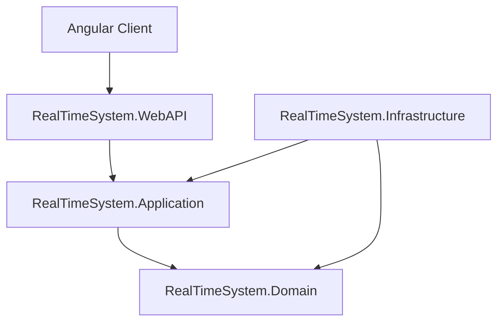
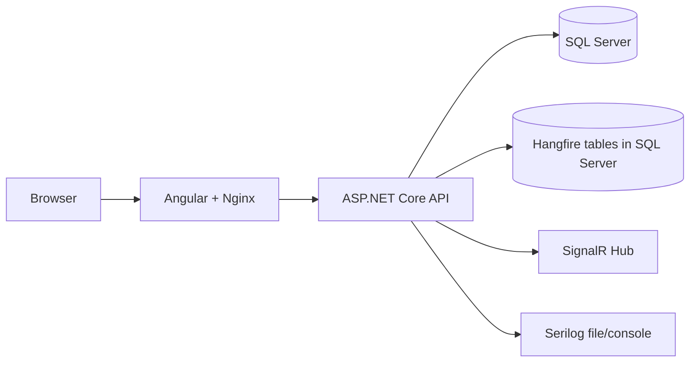
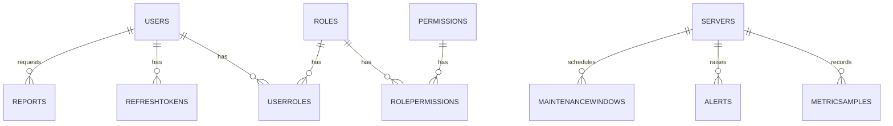

# ARCHITECTURE

## 1. High-Level Architecture

The solution follows a Clean Architecture style with strict project boundaries:

- **Domain**: business entities, enums, domain events, core rules
- **Application**: use cases (CQRS handlers), validation, contracts (DTOs), interfaces
- **Infrastructure**: EF Core persistence, auth/token services, jobs, external adapters
- **WebAPI**: HTTP entrypoint, middleware, controllers, SignalR hub, DI composition root
- **Client**: Angular SPA for visualization and operations



Dependency direction is inward toward Domain/Application abstractions.

---

## 2. Runtime View



---

## 3. Clean Architecture Implementation Details

### Domain Layer

- Contains entity models such as `MonitoredServer`, `MetricSample`, `Alert`, `Report`, `MaintenanceWindow`
- Contains identity entities split by class (`User`, `Role`, `Permission`, `UserRole`, `RolePermission`, `RefreshToken`)
- Shared base classes:
  - `BaseAuditableEntity` (created/modified/by + active/delete flags)
  - `BaseEntity` (identity key)
- Domain event contracts in `Domain/Events`

### Application Layer

- CQRS feature folders with separated files for:
  - command/query request
  - handler
  - validator (where needed)
- Pagination abstractions and DTOs in `Application/Common`
- Mapping/projection logic in `Application/Common/Mapping`
- Interfaces (ports) used by handlers:
  - `IUnitOfWork`, `IRepository<>`
  - `ITokenService`, `IAuthTokenIssuer`
  - `IMonitoringNotifier`, `IBackgroundJobScheduler`

### Infrastructure Layer

- EF Core DbContext + entity configurations
- Repository + Unit of Work implementation
- SQL Server enforcement in DI configuration
- Hangfire integration (scheduling/monitoring adapters)
- Security services (JWT, hasher, current user)
- Monitoring services (sample factory, domain event dispatch)

### WebAPI Layer

- Base API controller with auth and rate-limiting defaults
- Versioned controllers (`v1` and `v2`)
- Global exception middleware and request logging middleware
- Swagger/OpenAPI setup
- SignalR hub for live updates

---

## 4. SOLID Principles (with implementation references)

### Single Responsibility Principle

- Each job class handles one concern:
  - `MetricsCollectionJob`
  - `GenerateReportJob`
  - `AnalyzeReportJob`
  - `MaintenanceJob`
- Each CQRS handler implements a single use case.

### Open/Closed Principle

- `IAnomalyRule` allows adding new metric/anomaly rules without changing orchestration logic.

### Liskov Substitution Principle

- Rules derived from threshold rule can replace the base abstraction safely.

### Interface Segregation Principle

- Focused interfaces for notifier, scheduler, token service, current-user context, metric factory.

### Dependency Inversion Principle

- Application handlers depend on interfaces, not concrete EF/JWT/Hangfire implementations.
- Implementations are wired in Infrastructure DI.

---

## 5. Design Patterns Used

- **CQRS**: separated commands and queries
- **Repository + Unit of Work**: persistence orchestration
- **Domain Events**: side-effect signaling after state changes
- **Strategy-like rule composition**: anomaly rules via `IAnomalyRule`
- **Adapter**: infrastructure services adapt framework components to application interfaces

---

## 6. Database Schema Diagram (Conceptual)



---

## 7. Folder Structure Explanation

```text
src/
  RealTimeSystem.Domain/
    Entities/
    Events/
    Services/
  RealTimeSystem.Application/
    Common/
    Features/
  RealTimeSystem.Infrastructure/
    Persistence/
    Services/
    BackgroundJobs/
  RealTimeSystem.WebAPI/
    Controllers/
    Hubs/
    Middleware/
client/
tests/
```

- `Features` in Application are organized by business capability.
- Infrastructure classes are separated by concern (security, monitoring, jobs, persistence).
